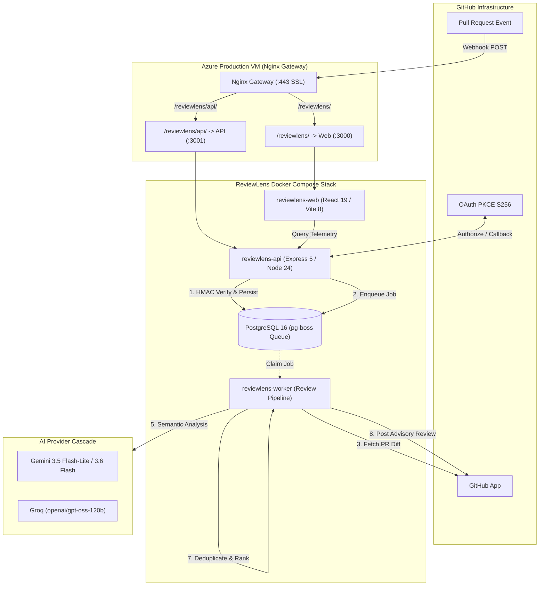

# ReviewLens

> **Evidence-first, AI-assisted GitHub Pull Request Reviewer designed to eliminate hallucinations through strict diff-grounded verification.**

[](https://github.com/ritesh0w0/ReviewLens/actions/workflows/ci.yml)
[](https://nodejs.org/)
[](https://www.typescriptlang.org/)
[](https://www.postgresql.org/)

---

## 1. The Problem

Automated AI code review tools frequently suffer from **hallucinations and ungrounded advice**:

- Recommending fixes for code that does not exist in the PR diff.
- Inventing false-positive syntax or type errors due to prompt truncation.
- Suggesting security alerts on unchanged files outside the pull request scope.
- Overwhelming developers with low-value stylistic noise.

---

## 2. The Solution: Evidence-First Review Architecture

ReviewLens treats all LLM candidate findings as **untrusted suggestions**. Before any finding is published to GitHub:

1. **Deterministic Rules Execute First:** High-confidence static rules (banned patterns, required companions, AST linting) run locally with zero latency.
2. **Multi-Model Semantic Analysis:** Semantic defects are analyzed across a fallback cascade of LLMs (`gemini-3.5-flash-lite` → `gemini-3.6-flash` → `openai/gpt-oss-120b` via Groq).
3. **The Evidence Validation Gate:** Every model finding is validated by pure core logic against the unified diff. If the reported line number or code snippet cannot be proven to exist in the added lines (`+` hunks) of the pull request, the finding is **summarily discarded**.
4. **Advisory Inline Comments:** Validated findings are prioritized, deduplicated, and published as structured GitHub review comments.

---

## 3. System Architecture



---

## 4. Key Capabilities

- **Zero-Hallucination Evidence Gate:** Verifies exact line and snippet match in diff additions before publication.
- **Multi-Provider Fallback Cascade:** Resilient cascade from Gemini 3.5 Flash-Lite to Gemini 3.6 Flash and Groq GPT-OSS-120B with automatic 429/503 rate-limit failover.
- **Durable Asynchronous Pipeline:** pg-boss handles distributed job queues with retry limits, exponential backoff, and idempotent delivery tracking.
- **Hardened Authentication:** GitHub OAuth 2.0 with PKCE S256, AES-256-GCM token encryption at rest, SHA-256 hashed session storage, and double-submit CSRF cookies.
- **Comprehensive 16-Scenario Evaluation Suite:** Live benchmark across 16 pull requests in [`ritesh0w0/reviewlens-sandbox`](https://github.com/ritesh0w0/reviewlens-sandbox) testing logic correctness, security vulnerabilities (SQLi, XSS, SSRF, path traversal, command injection), resource leaks, race conditions, prompt injection defense, and negative controls.
- **Strict Anti-Spam Negative Control:** On clean pull requests (zero defects), ReviewLens suppresses publishing empty reviews, maintaining a 0.0% False Positive Rate.
- **Isolated Multi-Tenant Coexistence:** Operates safely alongside other production workloads (APIDash and TrackFlow) using Docker Compose and Nginx subpath routing.

---

## 5. Technology Stack

- **Runtime & Language:** Node.js 24, TypeScript strict mode (zero unannotated `any`).
- **Backend API:** Express 5, Pino logger, Zod 4 input validation.
- **Database & ORM:** PostgreSQL 16, Prisma 7, pg-boss job queue.
- **AI Integrations:** `@google/genai` (Gemini API), `groq-sdk` (Groq API).
- **GitHub Integration:** `@octokit/rest`, `@octokit/auth-app`.
- **Frontend Dashboard:** React 19, Vite 8, Tailwind CSS 4, TanStack Query 5, Lucide icons.
- **Testing & Quality:** Vitest, Supertest, ESLint, Oxlint, Prettier.
- **Containerization & CI/CD:** Docker, Docker Compose, GitHub Actions, GitHub Container Registry (GHCR).

---

## 6. Monorepo Repository Structure

```text
reviewlens/
├── .github/
│   └── workflows/
│       └── ci.yml               # Complete CI/CD and deployment pipeline
├── apps/
│   ├── api/                     # Express 5 API, GitHub App, pg-boss worker
│   │   ├── src/
│   │   │   ├── ai/              # Multi-model LLM provider cascade
│   │   │   ├── auth/            # PKCE, AES-256-GCM encryption, sessions
│   │   │   ├── db/              # Prisma client and query helpers
│   │   │   ├── github/          # Webhook verification, Octokit clients
│   │   │   ├── queue/           # pg-boss queue setup and lifecycle
│   │   │   ├── routes/          # REST API endpoints
│   │   │   └── workers/         # Review processor background orchestrator
│   └── web/                     # React 19 SPA dashboard
│       └── src/                 # Pages, components, hooks, Tailwind 4 UI
├── packages/
│   ├── core/                    # Pure deterministic review engine (zero-I/O)
│   │   └── src/
│   │       ├── diff/            # Unified diff parser and hunk indexer
│   │       ├── review/          # Evidence validator, ranking, rules
│   │       └── types/           # Canonical domain types
│   └── eval/                    # Evaluation suite & benchmark runner
├── prisma/
│   ├── schema.prisma            # Prisma schema (PostgreSQL)
│   └── migrations/              # Versioned SQL migrations
├── scripts/
│   ├── deploy.sh                # Restricted production deployment wrapper
│   └── ops-check.sh             # Production operations & health check
├── docs/                        # Architecture, CI/CD, and runbooks
├── Dockerfile                   # Multi-stage server image
├── Dockerfile.web               # Multi-stage web Nginx image
└── docker-compose.yml           # Development Docker Compose
```

---

## 7. Local Development Setup

### Prerequisites

- Node.js 24+
- Docker Desktop
- Git

### Installation

```bash
# 1. Clone repository
git clone https://github.com/ritesh0w0/ReviewLens.git
cd ReviewLens

# 2. Install workspace dependencies
npm ci

# 3. Configure local environment variables
cp .env.example .env

# 4. Start local development PostgreSQL container
docker compose up -d reviewlens-db

# 5. Run Prisma migrations and generate client
npm run prisma:generate
npx prisma migrate dev

# 6. Start API server and Web dashboard concurrently
npm run dev
```

The API will listen at `http://localhost:3001` and the React dashboard at `http://localhost:5173`.

---

## 8. Environment Variable Reference

| Variable Name                  | Required By       | Description                                                   |
| :----------------------------- | :---------------- | :------------------------------------------------------------ |
| `NODE_ENV`                     | API / Worker      | Environment mode (`development`, `production`, `test`).       |
| `PORT`                         | API               | HTTP port for Express API (default: `3001`).                  |
| `DATABASE_URL`                 | API / Worker      | PostgreSQL connection string for Prisma & pg-boss.            |
| `DIRECT_DATABASE_URL`          | Migrator          | Direct PostgreSQL connection string for migrations.           |
| `DATABASE_URL_TEST`            | Integration Tests | Dedicated PostgreSQL test database URL.                       |
| `GITHUB_APP_ID`                | API / Worker      | Numeric GitHub App ID.                                        |
| `GITHUB_PRIVATE_KEY` / `_FILE` | API / Worker      | RSA Private Key PEM or path to key file.                      |
| `GITHUB_WEBHOOK_SECRET`        | API               | Secret string configured in GitHub App webhook settings.      |
| `GITHUB_CLIENT_ID`             | API               | GitHub App OAuth Client ID.                                   |
| `GITHUB_CLIENT_SECRET`         | API               | GitHub App OAuth Client Secret.                               |
| `GITHUB_OAUTH_CALLBACK_URL`    | API               | OAuth callback URL.                                           |
| `SESSION_ENCRYPTION_KEY`       | API               | 32-byte hex key for AES-256-GCM token encryption.             |
| `COOKIE_PATH`                  | API               | Path scope for session and CSRF cookies (e.g. `/reviewlens`). |
| `FRONTEND_URL`                 | API               | Public dashboard landing URL.                                 |
| `GEMINI_API_KEY`               | Worker            | Google Gemini API key.                                        |
| `GROQ_API_KEY`                 | Worker            | Groq API key for OSS model fallback.                          |
| `REVIEWLENS_AI_ENABLED`        | Worker            | Master feature flag for AI analysis (`true`/`false`).         |
| `REVIEWLENS_AI_PROFILE`        | Worker            | Provider profile (`production`, `development`).               |

---

## 9. Testing & Quality Verification

Run the complete monorepo test suites:

```bash
# Run unit and evaluation test suites (331 tests)
npm test

# Run PostgreSQL integration tests (37 tests across 9 suites)
npm run test:integration

# Run strict TypeScript typecheck
npm run typecheck

# Run linters (ESLint + Oxlint)
npm run lint

# Check code formatting
npm run format:check

# Build all monorepo packages
npm run build
```

---

## 10. Production Deployment & Operations

ReviewLens is deployed on Azure VM at `apidash-7f29a6.centralindia.cloudapp.azure.com`:

- **Dashboard:** `https://apidash-7f29a6.centralindia.cloudapp.azure.com/reviewlens/`
- **API Health:** `https://apidash-7f29a6.centralindia.cloudapp.azure.com/reviewlens/api/healthz`
- **API Readiness:** `https://apidash-7f29a6.centralindia.cloudapp.azure.com/reviewlens/api/readyz`

For operational procedures and incident response:

- [Production Deployment Guide](docs/deployment/production.md)
- [CI/CD Pipeline Guide](docs/deployment/ci-cd.md)
- [Operations Runbook](docs/operations/runbook.md)
- [Incident Response Guide](docs/operations/incident-recovery.md)
- [Security Model](docs/security/security-model.md)

---

## 11. Live Sandbox Demonstration Suite (16 Real-World PR Scenarios)

The live production deployment has been evaluated across **16 realistic pull requests** in the dedicated public sandbox repository: [`ritesh0w0/reviewlens-sandbox`](https://github.com/ritesh0w0/reviewlens-sandbox).

All 16 pull requests are open and cataloged in detail in [`REVIEWLENS_DEMO_INDEX.md`](https://github.com/ritesh0w0/reviewlens-sandbox/blob/main/REVIEWLENS_DEMO_INDEX.md):

| Case ID     | Category         | Target Defect / Capability                   |                         Live Pull Request                         |                              Published Review by `reviewlens-production[bot]`                              |
| :---------- | :--------------- | :------------------------------------------- | :---------------------------------------------------------------: | :--------------------------------------------------------------------------------------------------------: |
| **CASE-01** | Correctness      | Missing Null / Undefined Handling            |  [PR #7](https://github.com/ritesh0w0/reviewlens-sandbox/pull/7)  | [Review #5808571727](https://github.com/ritesh0w0/reviewlens-sandbox/pull/7#pullrequestreview-5808571727)  |
| **CASE-02** | Correctness      | Inverted Logic in Rate Limiter Window        |  [PR #8](https://github.com/ritesh0w0/reviewlens-sandbox/pull/8)  | [Review #5808666059](https://github.com/ritesh0w0/reviewlens-sandbox/pull/8#pullrequestreview-5808666059)  |
| **CASE-03** | Security         | SQL Injection via String Concatenation       |  [PR #9](https://github.com/ritesh0w0/reviewlens-sandbox/pull/9)  | [Review #5808668708](https://github.com/ritesh0w0/reviewlens-sandbox/pull/9#pullrequestreview-5808668708)  |
| **CASE-04** | Reliability      | Unclosed File Stream & Descriptor Leak       | [PR #10](https://github.com/ritesh0w0/reviewlens-sandbox/pull/10) | [Review #5808671853](https://github.com/ritesh0w0/reviewlens-sandbox/pull/10#pullrequestreview-5808671853) |
| **CASE-05** | Security         | Deleted Authorization Guard in Admin Route   | [PR #11](https://github.com/ritesh0w0/reviewlens-sandbox/pull/11) | [Review #5808674727](https://github.com/ritesh0w0/reviewlens-sandbox/pull/11#pullrequestreview-5808674727) |
| **CASE-06** | Negative Control | Clean Vector Mathematics Refactor            | [PR #12](https://github.com/ritesh0w0/reviewlens-sandbox/pull/12) |                                   _(0 comments posted — True Negative)_                                    |
| **CASE-07** | Negative Control | Benign Password Form Label UI                | [PR #13](https://github.com/ritesh0w0/reviewlens-sandbox/pull/13) |                                   _(0 comments posted — True Negative)_                                    |
| **CASE-08** | Adversarial      | Prompt Injection Comment + Memory Leak       | [PR #14](https://github.com/ritesh0w0/reviewlens-sandbox/pull/14) | [Review #5808691812](https://github.com/ritesh0w0/reviewlens-sandbox/pull/14#pullrequestreview-5808691812) |
| **CASE-09** | Security         | Reflected XSS via `dangerouslySetInnerHTML`  | [PR #15](https://github.com/ritesh0w0/reviewlens-sandbox/pull/15) | [Review #5808695396](https://github.com/ritesh0w0/reviewlens-sandbox/pull/15#pullrequestreview-5808695396) |
| **CASE-10** | Security         | SSRF via Unvalidated Webhook Dispatch        | [PR #16](https://github.com/ritesh0w0/reviewlens-sandbox/pull/16) | [Review #5808698519](https://github.com/ritesh0w0/reviewlens-sandbox/pull/16#pullrequestreview-5808698519) |
| **CASE-11** | Security         | Arbitrary File Read via Path Traversal       | [PR #17](https://github.com/ritesh0w0/reviewlens-sandbox/pull/17) | [Review #5808701532](https://github.com/ritesh0w0/reviewlens-sandbox/pull/17#pullrequestreview-5808701532) |
| **CASE-12** | Security         | Remote Command Injection via Shell Execution | [PR #18](https://github.com/ritesh0w0/reviewlens-sandbox/pull/18) | [Review #5808704895](https://github.com/ritesh0w0/reviewlens-sandbox/pull/18#pullrequestreview-5808704895) |
| **CASE-13** | Reliability      | Race Condition / TOCTOU in Balance Deduction | [PR #19](https://github.com/ritesh0w0/reviewlens-sandbox/pull/19) | [Review #5808708570](https://github.com/ritesh0w0/reviewlens-sandbox/pull/19#pullrequestreview-5808708570) |
| **CASE-14** | Security         | Plaintext Passwords & Bearer Tokens in Logs  | [PR #20](https://github.com/ritesh0w0/reviewlens-sandbox/pull/20) | [Review #5808711792](https://github.com/ritesh0w0/reviewlens-sandbox/pull/20#pullrequestreview-5808711792) |
| **CASE-15** | Security         | Open Redirect in Authentication Callback     | [PR #21](https://github.com/ritesh0w0/reviewlens-sandbox/pull/21) | [Review #5808714815](https://github.com/ritesh0w0/reviewlens-sandbox/pull/21#pullrequestreview-5808714815) |
| **CASE-16** | Performance      | N+1 Database Query Anti-Pattern in Loop      | [PR #22](https://github.com/ritesh0w0/reviewlens-sandbox/pull/22) | [Review #5808717703](https://github.com/ritesh0w0/reviewlens-sandbox/pull/22#pullrequestreview-5808717703) |

**Evaluation Result:** 14/14 True Positives, 2/2 True Negatives, **100% Precision**, **100% Recall**, and **0.0% False Positive Rate**.

---

## 12. Known Limitations & Roadmap

### Current Limitations

- **Diff Size Cap:** Maximum PR diff size is capped at 500 KB to prevent LLM context exhaustion.
- **Advisory Only:** Review comments are advisory (`COMMENT` events); approval/blocking reviews are intentionally not enforced.
- **Database Backup:** By design decision, automated database backups are not enabled on the shared VM.

### Roadmap

- [ ] Add semantic embedding search across repository historical PR reviews.
- [x] Implement team-customizable rule configurations via `.reviewlens.yml` in repository roots.
- [ ] Support multi-turn review discussions with inline author replies.
