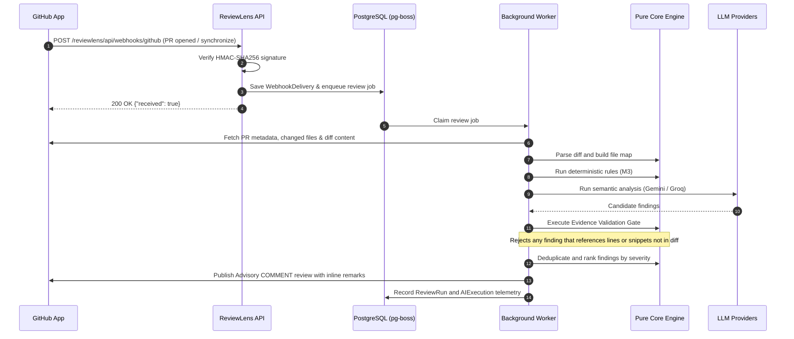

# ReviewLens — Architecture Overview

ReviewLens is an evidence-first, AI-assisted GitHub Pull Request Reviewer designed to eliminate LLM hallucinations by enforcing strict diff-evidence grounding before any finding can be published.

---

## 1. System Architecture Diagram

```mermaid
flowchart TD
    subgraph GitHub ["GitHub Infrastructure"]
        GH_PR["Pull Request Event"]
        GH_APP["GitHub App"]
        GH_OAUTH["OAuth / PKCE S256"]
    end

    subgraph Host ["Azure VM (Nginx Gateway)"]
        NGINX["Nginx Reverse Proxy (:443 SSL)"]
        NG_APIDASH["APIDash (:5000)"]
        NG_TRACKFLOW["TrackFlow (:5001)"]
        NG_RL_WEB["/reviewlens/ -> Web (:3000)"]
        NG_RL_API["/reviewlens/api/ -> API (:3001)"]
    end

    subgraph ReviewLens_Stack ["ReviewLens Isolated Docker Compose"]
        WEB["reviewlens-web (Nginx/React 19)"]
        API["reviewlens-api (Express 5 / Node 24)"]
        WORKER["reviewlens-worker (Review Engine)"]
        DB[("PostgreSQL 16 (reviewlens_pgdata)")]
    end

    subgraph AI_Providers ["Multi-Provider AI Architecture"]
        GEMINI["Gemini 3.5 Flash-Lite / 3.6 Flash"]
        GROQ["Groq (openai/gpt-oss-120b)"]
    end

    GH_PR -->|Webhook POST| NGINX
    NGINX -->|/| NG_APIDASH
    NGINX -->|/trackflow/| NG_TRACKFLOW
    NGINX -->|/reviewlens/| NG_RL_WEB
    NGINX -->|/reviewlens/api/| NG_RL_API

    NG_RL_WEB --> WEB
    NG_RL_API --> API

    API -->|1. Verify Signature & Persist| DB
    API -->|2. Enqueue Job| DB
    DB -.->|pg-boss Polling| WORKER

    WORKER -->|3. Fetch PR Diff & Context| GH_APP
    WORKER -->|4. Deterministic AST/Regex Rules| WORKER
    WORKER -->|5. Semantic Defect Analysis| AI_Providers
    WORKER -->|6. Diff Evidence Gate (Reject Ungrounded)| WORKER
    WORKER -->|7. Deduplicate & Prioritize| WORKER
    WORKER -->|8. Publish Advisory Review Comment| GH_APP

    WEB -->|OAuth & Telemetry Query| API
    GH_OAUTH <-->|Authorize / Callback| API
```

---

## 2. Monorepo Package Topology

ReviewLens enforces clean architectural boundaries across four workspaces:

- **`packages/core`**: Pure, deterministic, zero-I/O review engine.
  - Diff parser (unified diff / patch).
  - Deterministic lint/pattern/security rules.
  - Evidence validation gate (strictly verifies that line numbers, line content, and code snippets exist in the actual PR diff).
  - Ranking, deduplication, and markdown comment formatting.
- **`packages/eval`**: Evaluation benchmarking suite.
  - 8 synthetic evaluation cases (memory leaks, injections, type mismatches, syntax errors, etc.).
  - Precision, Recall, and F1 scoring against ground truth.
- **`apps/api`**: I/O boundaries and server operations.
  - Express 5 REST API with dual routing (`/healthz`, `/api/healthz`).
  - Webhook ingestion with raw HMAC-SHA256 signature verification.
  - GitHub App integration via `@octokit/auth-app` and `@octokit/rest`.
  - pg-boss job queue scheduling.
  - Background worker review orchestrator.
  - GitHub OAuth 2.0 PKCE authentication flow.
- **`apps/web`**: Authenticated web dashboard.
  - React 19, Vite 8, Tailwind CSS 4, TanStack Query 5.
  - Subpath-aware base routing (`/reviewlens/`).
  - CSRF protection and HTTP-only session tokens.

---

## 3. The 8-Stage Review Pipeline



---

## 4. Multi-Provider Fallback Architecture

To ensure high availability and rate-limit resilience:

1. **Primary Model:** `gemini-3.5-flash-lite` (rapid semantic analysis).
2. **Secondary Fallback:** `gemini-3.6-flash` (higher capacity analysis).
3. **Tertiary Fallback:** `openai/gpt-oss-120b` via Groq (independent infrastructure fallback).

If an upstream provider returns 429 (Rate Limit) or 503 (Unavailable), the orchestrator automatically cascades to the next healthy provider in the configured profile without failing the review job.

---

## 5. Security & Isolation Architecture

1. **Host Coexistence:** APIDash and TrackFlow run natively on the Azure host. ReviewLens runs in an isolated Docker Compose project with private network `reviewlens_internal`.
2. **Database Isolation:** PostgreSQL 16 does not publish port 5432 to the host network. All database access occurs within `reviewlens_internal`.
3. **Secret Protection:** Secrets are stored in `/opt/reviewlens/secrets/prod.env` with `0600` permissions. Token encryption at rest uses AES-256-GCM.
4. **Least-Privilege CI/CD:** Restricted user `deploy-reviewlens` can only execute `/opt/reviewlens/bin/deploy.sh` and `/opt/reviewlens/bin/ops-check.sh` via sudo.
