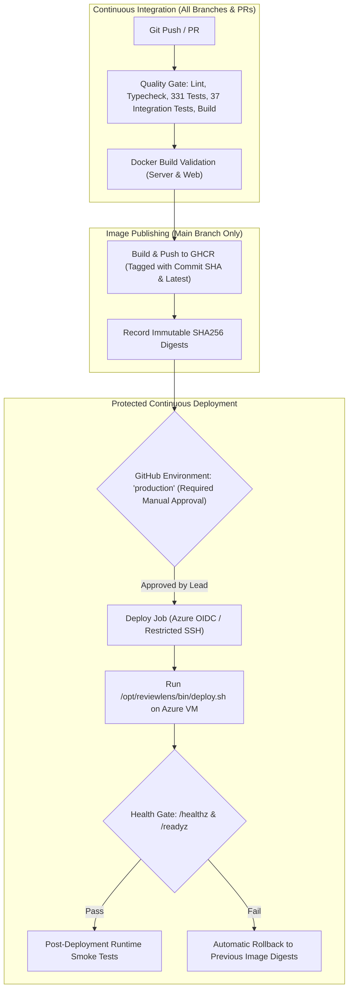

# ReviewLens — Continuous Integration & Continuous Delivery (CI/CD)

ReviewLens uses GitHub Actions for continuous integration, immutable container packaging, and protected continuous delivery.

---

## 1. CI/CD Architecture Flow



---

## 2. GitHub Actions Workflow Jobs

Defined in [`.github/workflows/ci.yml`](file:///C:/Users/rites/Projects/reviewlens/.github/workflows/ci.yml):

| Job                          | Triggers                   | Permissions                         | Key Actions                                                                                                                                                                       |
| :--------------------------- | :------------------------- | :---------------------------------- | :-------------------------------------------------------------------------------------------------------------------------------------------------------------------------------- |
| **`verify`**                 | All PRs & pushes to `main` | `contents: read`                    | Runs PostgreSQL 16 service container, Prisma migrations, strict typecheck, ESLint, Oxlint, Vitest unit & eval tests, Supertest integration tests, and monorepo production builds. |
| **`docker-validate`**        | All PRs & pushes to `main` | `contents: read`                    | Builds multi-stage `reviewlens-server` and `reviewlens-web` Docker images with `push: false`.                                                                                     |
| **`publish-images`**         | Pushes to `main` only      | `contents: read`, `packages: write` | Logs in to `ghcr.io` via `GITHUB_TOKEN`, builds images with GHA build caching, pushes tagged images, and captures exact SHA256 digests.                                           |
| **`deploy-production`**      | Pushes to `main` only      | `contents: read`, `id-token: write` | Targets protected `production` environment with manual approval gate; connects via OIDC / restricted SSH; runs `/opt/reviewlens/bin/deploy.sh`.                                   |
| **`post-deployment-verify`** | Post-deploy on `main`      | `contents: read`                    | Probes live HTTPS endpoints (`/reviewlens/`, `/api/healthz`, `/api/readyz`) and verifies APIDash/TrackFlow non-interference.                                                      |

---

## 3. GHCR Image Tagging & Digest Immutability

Published images use three immutable identifiers:

1. `ghcr.io/ritesh0w0/reviewlens-server:<commit-sha>`
2. `ghcr.io/ritesh0w0/reviewlens-server:sha-<commit-sha>`
3. `ghcr.io/ritesh0w0/reviewlens-server:latest`

**Production deployments strictly use the immutable image digest:**

```text
ghcr.io/ritesh0w0/reviewlens-server@sha256:<64-hex-digest>
ghcr.io/ritesh0w0/reviewlens-web@sha256:<64-hex-digest>
```

Mutable tags like `latest` are never used for production deployments.

---

## 4. Protected Production Environment Configuration

In your GitHub repository settings under **Settings -> Environments -> production**:

1. **Required Reviewers:** Check **Required reviewers** and assign the repository owner / lead engineer.
2. **Deployment Branches:** Restrict to `main`.
3. **Environment Secrets:**
   - `DEPLOY_SSH_KEY`: The private ED25519 key for `deploy-reviewlens` (located securely in your local `secrets/deploy_ed25519`).
4. **Environment Variables:**
   - `DEPLOY_SSH_HOST`: `apidash-7f29a6.centralindia.cloudapp.azure.com`
   - `DEPLOY_SSH_USER`: `deploy-reviewlens`

---

## 5. Azure OIDC & Entra ID Integration Guide

ReviewLens supports passwordless OpenID Connect (OIDC) between GitHub Actions and Microsoft Entra ID:

1. **App Registration / Managed Identity:**
   Create an Entra ID App Registration or User-Assigned Managed Identity `id-reviewlens-deploy`.
2. **Federated Credential:**
   - Entity type: `Environment`
   - Environment name: `production`
   - Issuer: `https://token.actions.githubusercontent.com`
   - Subject: `repo:ritesh0w0/reviewlens:environment:production`
3. **Configure GitHub Environment Variables:**
   - `AZURE_CLIENT_ID`: Application (client) ID.
   - `AZURE_TENANT_ID`: Directory (tenant) ID.
   - `AZURE_SUBSCRIPTION_ID`: `a9fe3c4e-1329-4106-9879-746dca4b2c49`.
