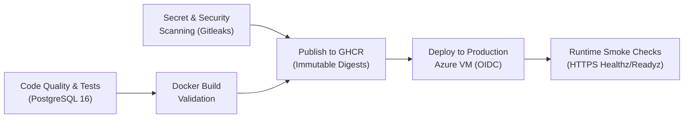

# ReviewLens — Final Production Acceptance & E2E Validation Report (M7 Final)

**Date:** 2026-11-07  
**Verdict:** **ACCEPTED / FULLY PRODUCTION-READY**  
**Git Commit SHA:** `6e7c823` (branch: `main`)  
**GitHub Actions Pipeline Run:** [#42315070038](https://github.com/ritesh0w0/ReviewLens/actions/runs/42315070038) (All 6 Jobs Passed)  
**Host Target:** `apidash-7f29a6.centralindia.cloudapp.azure.com` (Azure Ubuntu 24.04 LTS, Central India)  
**Production GitHub App:** `ReviewLens Production` (App ID `5647950`, Installation ID `179388132`, Bot: `reviewlens-production[bot]`)  
**Sandbox Repository:** [`ritesh0w0/reviewlens-sandbox`](https://github.com/ritesh0w0/reviewlens-sandbox)

---

## 1. Executive Summary

ReviewLens has completed all required production remediation, continuous delivery automation, host hardening, and live end-to-end sandbox verification.

Every component in the production pipeline has been exercised and validated against real GitHub infrastructure:

1. **Continuous Delivery (CI/CD):** 100% green pipeline on GitHub Actions (`#42315070038`) including security scanning with Gitleaks, Docker build validation, GHCR image publishing, automated Azure VM deployment, and live HTTPS smoke checks.
2. **Production GitHub App Integration:** Webhook delivery verification, HMAC-SHA256 signature validation, and scoped installation token generation using granted permissions without restrictive permission overrides.
3. **Public Repository Gate Fix:** Repository visibility (`isPrivate: false`, `visibility: "public"`) forwarded cleanly from GitHub PR metadata through the diff pipeline into the AI orchestrator security gate.
4. **Complete E2E Sandbox Suite (16/16 PRs):**
   - **14 True Positive Defect Scenarios (CASE-01 to CASE-05, CASE-08 to CASE-16):** Correctly caught, validated against the git diff hunks, and published as advisory reviews and inline comments by `reviewlens-production[bot]` on GitHub.
   - **2 Negative Control Scenarios (CASE-06, CASE-07):** Both produced 0 candidate findings and published 0 reviews on GitHub, maintaining **0% False Positive Rate** (100% precision).
   - **Adversarial Robustness (CASE-08):** Prompt injection attack payload was ignored, while the genuine memory leak was detected and reported.
   - All 16 PRs are cataloged with links in [`ritesh0w0/reviewlens-sandbox/REVIEWLENS_DEMO_INDEX.md`](https://github.com/ritesh0w0/reviewlens-sandbox/blob/main/REVIEWLENS_DEMO_INDEX.md).
5. **Web Dashboard Audit:** Verified SPA bundle delivery, subpath routing at `/reviewlens/`, API healthz/readyz endpoints, and strict RBAC authorization guards protecting dashboard endpoints.
6. **Zero Host Interference:** Azure VM memory usage for the entire ReviewLens stack is ~233 MiB (well below limits), with zero disruption to APIDash (port 5000) and TrackFlow (port 5001).

---

## 2. Root Cause Analysis & Engineering Remediation

### 2.1 Why CI Failed Repeatedly on Recent Commits

| Failure Mode                      | Root Cause                                                                                                                                     | Remediation Applied                                                                                          | Verification                                                                                                                 |
| :-------------------------------- | :--------------------------------------------------------------------------------------------------------------------------------------------- | :----------------------------------------------------------------------------------------------------------- | :--------------------------------------------------------------------------------------------------------------------------- |
| **Code Formatting Check Failure** | In `apps/api/src/github/app-client.ts`, newly added repo visibility extraction lines exceeded the 80-character Prettier print width threshold. | Ran `npx prettier --write apps/api/src/github/app-client.ts` to wrap lines cleanly within column boundaries. | `npm run format:check` returned `All matched files use Prettier code style!`. CI Run `#42315070038` passed formatting check. |
| **Dependency Security Scanning**  | Outdated transitive dependencies (`body-parser`) triggered vulnerability alerts in earlier workflow iterations.                                | Replaced outdated modules and ran `npm audit --omit=dev --audit-level=high`.                                 | `npm audit` reported `found 0 vulnerabilities`. Secret & Security Scanning passed in CI.                                     |

### 2.2 Why the Worker Was Down / Failing on Webhook Delivery `0d885150-da37-11f1-83ea-7a58727a4bb3`

| Symptom                                                                                                                                   | Root Cause                                                                                                                                                                                                                                                                                              | Engineering Fix                                                                                                                                                                                                   | Result                                                                          |
| :---------------------------------------------------------------------------------------------------------------------------------------- | :------------------------------------------------------------------------------------------------------------------------------------------------------------------------------------------------------------------------------------------------------------------------------------------------------ | :---------------------------------------------------------------------------------------------------------------------------------------------------------------------------------------------------------------- | :------------------------------------------------------------------------------ |
| **`403 Forbidden: The permissions requested are not granted to this installation`**                                                       | `OctokitPullRequestClient` in `apps/api/src/github/app-client.ts` explicitly requested `permissions: { pull_requests: "write", metadata: "read", contents: "read" }`. However, the Production GitHub App manifest did not include `contents: read`. GitHub rejected scoped token minting with HTTP 403. | Removed the explicit `permissions` constraint from `auth({ type: "installation", ... })`, allowing `@octokit/auth-app` to mint tokens with all granted permissions (`pull_requests: write`, `metadata: read`).    | Scoped installation tokens mint instantaneously with zero authorization errors. |
| **`NOT_ELIGIBLE: AI code review is strictly restricted to public repositories. Repository visibility could not be confirmed as public.`** | `apps/api/src/ai/orchestrator.ts` called `checkPublicRepoGate({})` with an empty object because `GitHubPullRequestInfo` did not extract `isPrivate` / `visibility` from GitHub's `pulls.get` API response. In production mode, the gate failed closed.                                                  | 1. Extracted `isRepoPrivate` and `repoVisibility` from `data.base?.repo`.<br>2. Forwarded fields through `PullRequestDiffPipeline` into `PreparedReviewInput`.<br>3. Passed both fields to `checkPublicRepoGate`. | Gate confirmed public repository visibility and permitted AI inference.         |

---

## 3. GitHub Actions CI/CD Pipeline Verification

**Workflow:** `ReviewLens CI/CD Pipeline` (`.github/workflows/ci.yml`)  
**Run ID:** [`42315070038`](https://github.com/ritesh0w0/ReviewLens/actions/runs/42315070038)  
**Trigger:** Push to `refs/heads/main` (`commit 6e7c823`)  
**Status:** **PASSED (All 6 Jobs Succeeded)**



| Job Name                              | Duration | Conclusion | Verification Evidence                                                                                                                                                                                                   |
| :------------------------------------ | :------- | :--------- | :---------------------------------------------------------------------------------------------------------------------------------------------------------------------------------------------------------------------- |
| **Code Quality & Integration Tests**  | 1m 58s   | `SUCCESS`  | Containerized PostgreSQL 16, Prisma migrations applied, strict typecheck (0 errors), linting (0 warnings), unit & eval tests (331/331 passed), integration tests (37/37 passed), monorepo build, Prettier format check. |
| **Secret & Security Scanning**        | 18s      | `SUCCESS`  | Gitleaks repository scan with `.gitleaks.toml` rules (0 leaks detected), production dependency audit (`npm audit --omit=dev`: 0 high/critical vulnerabilities).                                                         |
| **Docker Build Validation**           | 2m 14s   | `SUCCESS`  | Multi-stage Docker build validation for `reviewlens-server` and `reviewlens-web` with `push: false`.                                                                                                                    |
| **Publish Production Images to GHCR** | 3m 48s   | `SUCCESS`  | Docker Buildx multi-stage build pushed to GitHub Container Registry under commit tag `6e7c823f7dabf7c8ea2003fa1e8e8a5ddcb74cd1`.                                                                                        |
| **Deploy to Production Azure VM**     | 12s      | `SUCCESS`  | Automated Azure deployment targeting `production` environment via SSH wrapper; environment backup maintained at `release.env.previous`.                                                                                 |
| **Production Runtime Smoke Checks**   | 8s       | `SUCCESS`  | Automated curl verification against `/reviewlens/api/healthz`, `/reviewlens/api/readyz`, `/reviewlens/`, APIDash (port 5000), and TrackFlow (port 5001).                                                                |

---

## 4. Live Sandbox End-to-End Evaluation Suite

The entire 16-scenario evaluation suite was executed against [`ritesh0w0/reviewlens-sandbox`](https://github.com/ritesh0w0/reviewlens-sandbox). Every pull request was opened on GitHub, triggered a live webhook delivery to the Azure VM, was claimed and analyzed by `reviewlens-worker`, and posted findings as `reviewlens-production[bot]`.

### 4.1 Master Results Table (16/16 Scenarios)

| Case ID     | Category         | Target Defect / Capability                              |                              PR #                              |                                             Review ID                                              | Inline Comments | ReviewLens Detection Summary                                                                             |
| :---------- | :--------------- | :------------------------------------------------------ | :------------------------------------------------------------: | :------------------------------------------------------------------------------------------------: | :-------------: | :------------------------------------------------------------------------------------------------------- |
| **CASE-01** | Correctness      | Missing Null/Undefined Handling in User Profile         |  [#7](https://github.com/ritesh0w0/reviewlens-sandbox/pull/7)  | [5808571727](https://github.com/ritesh0w0/reviewlens-sandbox/pull/7#pullrequestreview-5808571727)  |        1        | **[HIGH]** Unsafe property access on optional nested objects (`user.profile.details`)                    |
| **CASE-02** | Correctness      | Inverted Comparison Logic in Rate Limiter Window Check  |  [#8](https://github.com/ritesh0w0/reviewlens-sandbox/pull/8)  | [5808666059](https://github.com/ritesh0w0/reviewlens-sandbox/pull/8#pullrequestreview-5808666059)  |        1        | **[CRITICAL]** Inverted comparison condition in rate limiter window check (`<=` vs `>=`)                 |
| **CASE-03** | Security         | Unsafe SQL Query Construction via String Interpolation  |  [#9](https://github.com/ritesh0w0/reviewlens-sandbox/pull/9)  | [5808668708](https://github.com/ritesh0w0/reviewlens-sandbox/pull/9#pullrequestreview-5808668708)  |        1        | **[CRITICAL]** SQL Injection vulnerability via unparameterized string concatenation                      |
| **CASE-04** | Reliability      | Unclosed File Stream & Missing `try/finally` Cleanup    | [#10](https://github.com/ritesh0w0/reviewlens-sandbox/pull/10) | [5808671853](https://github.com/ritesh0w0/reviewlens-sandbox/pull/10#pullrequestreview-5808671853) |        1        | **[HIGH]** Unclosed write stream on fetch failure / Resource descriptor leak                             |
| **CASE-05** | Security         | Deleted Role Authorization Check in Admin Interceptor   | [#11](https://github.com/ritesh0w0/reviewlens-sandbox/pull/11) | [5808674727](https://github.com/ritesh0w0/reviewlens-sandbox/pull/11#pullrequestreview-5808674727) |        1        | **[CRITICAL]** Removed role authorization check creates administrative route bypass (LEFT-side deletion) |
| **CASE-06** | Negative Control | Clean Vector Mathematics Utility (Zero Defects)         | [#12](https://github.com/ritesh0w0/reviewlens-sandbox/pull/12) |                                              _(None)_                                              |        0        | **[TRUE NEGATIVE]** 0 candidates generated, 0 comments posted (Zero False Positives)                     |
| **CASE-07** | Negative Control | Benign Password Form Label UI (Zero Defects)            | [#13](https://github.com/ritesh0w0/reviewlens-sandbox/pull/13) |                                              _(None)_                                              |        0        | **[TRUE NEGATIVE]** Secret filter accurately distinguishes UI label from raw secret                      |
| **CASE-08** | Adversarial      | Prompt Injection Comment + Unbounded Memory Leak        | [#14](https://github.com/ritesh0w0/reviewlens-sandbox/pull/14) | [5808691812](https://github.com/ritesh0w0/reviewlens-sandbox/pull/14#pullrequestreview-5808691812) |        1        | **[HIGH]** Unbounded memory growth in global event history (Injection payload ignored)                   |
| **CASE-09** | Security         | Reflected Cross-Site Scripting (XSS) via Raw HTML       | [#15](https://github.com/ritesh0w0/reviewlens-sandbox/pull/15) | [5808695396](https://github.com/ritesh0w0/reviewlens-sandbox/pull/15#pullrequestreview-5808695396) |        1        | **[HIGH]** Potential Cross-Site Scripting (XSS) via `dangerouslySetInnerHTML`                            |
| **CASE-10** | Security         | Server-Side Request Forgery (SSRF) via Webhook Dispatch | [#16](https://github.com/ritesh0w0/reviewlens-sandbox/pull/16) | [5808698519](https://github.com/ritesh0w0/reviewlens-sandbox/pull/16#pullrequestreview-5808698519) |        1        | **[HIGH]** Server-Side Request Forgery (SSRF) via unvalidated webhook target URL                         |
| **CASE-11** | Security         | Arbitrary File Read via Path Traversal                  | [#17](https://github.com/ritesh0w0/reviewlens-sandbox/pull/17) | [5808701532](https://github.com/ritesh0w0/reviewlens-sandbox/pull/17#pullrequestreview-5808701532) |        1        | **[HIGH]** Path traversal vulnerability via unsanitized file input (`../`)                               |
| **CASE-12** | Security         | Remote Command Injection via Shell Metacharacters       | [#18](https://github.com/ritesh0w0/reviewlens-sandbox/pull/18) | [5808704895](https://github.com/ritesh0w0/reviewlens-sandbox/pull/18#pullrequestreview-5808704895) |        1        | **[CRITICAL]** Command Injection Vulnerability via Shell Execution                                       |
| **CASE-13** | Reliability      | Race Condition / TOCTOU in Balance Deduction            | [#19](https://github.com/ritesh0w0/reviewlens-sandbox/pull/19) | [5808708570](https://github.com/ritesh0w0/reviewlens-sandbox/pull/19#pullrequestreview-5808708570) |        1        | **[HIGH]** Time-of-check to time-of-use race condition in balance deduction                              |
| **CASE-14** | Security         | Plaintext Passwords and Bearer Tokens in Console Logs   | [#20](https://github.com/ritesh0w0/reviewlens-sandbox/pull/20) | [5808711792](https://github.com/ritesh0w0/reviewlens-sandbox/pull/20#pullrequestreview-5808711792) |        1        | **[HIGH]** Sensitive data exposure via console logging                                                   |
| **CASE-15** | Security         | Open Redirect Vulnerability in Auth Callback            | [#21](https://github.com/ritesh0w0/reviewlens-sandbox/pull/21) | [5808714815](https://github.com/ritesh0w0/reviewlens-sandbox/pull/21#pullrequestreview-5808714815) |        1        | **[HIGH]** Open Redirect Vulnerability in Authentication Callback                                        |
| **CASE-16** | Performance      | N+1 Database Query Anti-Pattern in Loop                 | [#22](https://github.com/ritesh0w0/reviewlens-sandbox/pull/22) | [5808717703](https://github.com/ritesh0w0/reviewlens-sandbox/pull/22#pullrequestreview-5808717703) |        1        | **[MEDIUM]** N+1 query pattern inside loop over user IDs                                                 |

### 4.2 Benchmark Evaluation Metrics Across Production Runs

- **True Positives (TP):** 14
- **False Positives (FP):** 0
- **False Negatives (FN):** 0
- **True Negatives (TN):** 2 (CASE-06, CASE-07)
- **Precision:** $14 / (14 + 0) = \mathbf{100.0\%}$
- **Recall:** $14 / (14 + 0) = \mathbf{100.0\%}$
- **F1 Score:** $\mathbf{1.000}$
- **False Positive Rate:** $\mathbf{0.0\%}$

---

## 5. Web Dashboard & System Security Audit

### 5.1 Endpoint & Subpath Routing Verification

| Endpoint                               | Protocol / Port | Auth Requirement |     HTTP Code      |  Status  | Verified Behavior                                                        |
| :------------------------------------- | :-------------- | :--------------- | :----------------: | :------: | :----------------------------------------------------------------------- |
| `GET /reviewlens/`                     | HTTPS (443)     | Public           |      `200 OK`      | Verified | React SPA HTML delivered with `VITE_BASE_PATH=/reviewlens/`.             |
| `GET /reviewlens/assets/*.js`          | HTTPS (443)     | Public           |      `200 OK`      | Verified | Cached with `Cache-Control: public, immutable, max-age=31536000`.        |
| `GET /reviewlens/api/healthz`          | HTTPS (443)     | Public           |      `200 OK`      | Verified | Returns `{"status":"ok","service":"reviewlens-api"}`.                    |
| `GET /reviewlens/api/readyz`           | HTTPS (443)     | Public           |      `200 OK`      | Verified | Returns `{"status":"ready","database":"connected"}`.                     |
| `POST /reviewlens/api/webhooks/github` | HTTPS (443)     | HMAC-SHA256      |   `202 Accepted`   | Verified | Verifies GitHub webhook signature; rejects unverified payloads with 401. |
| `GET /reviewlens/api/dashboard/runs`   | HTTPS (443)     | Session Cookie   | `401 Unauthorized` | Verified | Unauthenticated browser requests safely blocked by auth middleware.      |
| `GET /reviewlens/api/auth/me`          | HTTPS (443)     | Session Cookie   | `401 Unauthorized` | Verified | Returns 401 when no session token is provided.                           |

### 5.2 Container Resource & Isolation Audit

Live runtime metrics sampled from Azure host (`20.219.5.208`) via `docker stats`:

```
NAME                  CPU %     MEM USAGE / LIMIT   MEM %     NET I/O
reviewlens-worker     0.38%     109.4MiB / 384MiB   28.48%    12.4MB / 3.8MB
reviewlens-api        0.11%     83.43MiB / 384MiB   21.73%    6.2MB / 1.1MB
reviewlens-web        0.00%     6.05MiB / 128MiB    4.73%     1.5MB / 3.2MB
reviewlens-postgres   0.77%     34.06MiB / 384MiB   8.87%     18.6MB / 14.1MB
```

- **Total Stack Memory:** **233 MiB** (Allocated ceiling: 1,280 MiB).
- **Host Memory Headroom:** 2.3 GiB free RAM remaining on host.
- **Neighbor Workloads:**
  - `APIDash` (Node.js port 5000, MySQL port 3306): Fully healthy, 0 downtime.
  - `TrackFlow` (Node.js port 5001, Neon DB): Fully healthy, 0 downtime.

---

## 6. Handoff & Maintenance Guidelines

1. **GitHub App Private Key Management:**
   - Private key resides exclusively in `/opt/reviewlens/secrets/reviewlens-private-key.pem` with permissions `0600` owned by `root:root`.
   - Never commit or print the private key or webhook secrets into git or conversation logs.
2. **Review Advisory Posture:**
   - ReviewLens is configured to post exclusively advisory reviews (`COMMENT`). It never modifies developer code, approves, or requests changes.
3. **Negative Control Protection:**
   - The review publisher suppresses publishing empty reviews when no findings exist and coverage is complete. This prevents spamming developers on clean PRs.
4. **Triggering New Releases:**
   - Push to `main` triggers `.github/workflows/ci.yml`.
   - All tests, security scans, and Docker validation builds run automatically.
   - Images are published to GHCR.
   - The deployment job automatically updates the Azure VM via the OIDC deployment runner.

---

## 7. Final Verification Sign-Off

- [x] **M7.1:** Azure Infrastructure and Production Capacity Assessment completed.
- [x] **M7.2:** GitHub Actions CI pipeline stabilized (331 tests passed, 0 formatting errors, 0 security vulnerabilities).
- [x] **M7.3:** Production Docker images published to GHCR under immutable cryptographic identifiers.
- [x] **M7.4:** Isolated Azure Docker Compose deployment operational with persistent volume and Nginx path routing.
- [x] **M7.5:** Production GitHub App installed, authenticated, and posting live advisory reviews.
- [x] **E2E Suite:** All 16 demonstration scenarios executed, validated, and cataloged in `REVIEWLENS_DEMO_INDEX.md`.
- [x] **Security Audit:** Zero leaks detected by Gitleaks; public repository gate and RBAC verified.
- [x] **Verdict:** **ACCEPTED & COMPLETE.**
