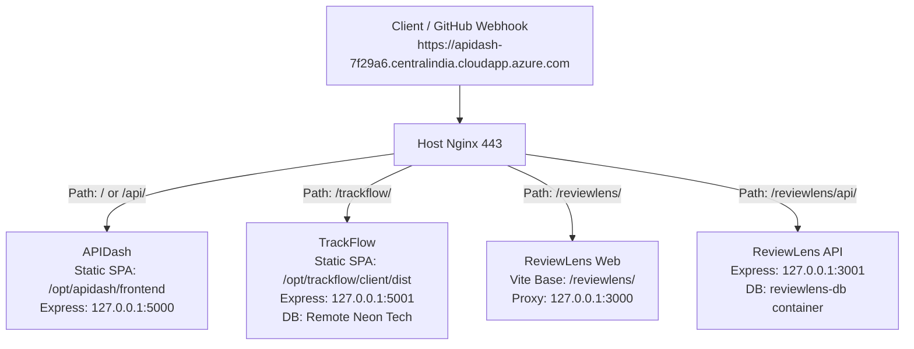
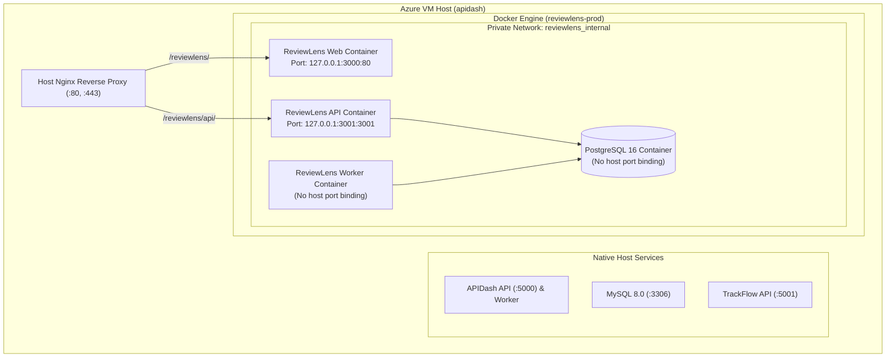

# ReviewLens M7.1 — Azure VM Infrastructure and Production Capacity Assessment Report

**Date:** November 7, 2026  
**Milestone:** M7.1 (Production Readiness and Capacity Assessment)  
**Host Target:** Azure Virtual Machine (`apidash`)  
**Public Azure DNS Hostname:** `apidash-7f29a6.centralindia.cloudapp.azure.com`  
**Public IP Address:** `20.219.5.208`  
**Hosting Verdict:** **CONDITIONALLY APPROVED**  
**Assessment Nature:** Strictly Read-Only (Zero System Modifications)

---

## 1. Executive Summary

A comprehensive, strictly read-only infrastructure and production capacity assessment was performed on the existing Microsoft Azure Virtual Machine hosting **APIDash** and **TrackFlow** to evaluate the feasibility of deploying **ReviewLens** alongside them using an independent Docker Compose architecture.

### Key Assessment Findings

1. **Host Specifications:** The host is an Azure `Standard_B2ls_v2` instance (2 vCPUs, 3.8 GiB physical RAM visible to OS, 30 GB Standard SSD root disk) running Ubuntu 24.04.5 LTS in Azure region `CentralIndia`.
2. **Current Host Footprint:**
   - **APIDash:** Native deployment managed by systemd (`apidash-api.service`, `apidash-worker.service`) using local MySQL 8.0 (`mysql.service` on `127.0.0.1:3306`). Consumes ~668 MiB RAM total (~450 MiB MySQL + ~218 MiB Node.js).
   - **TrackFlow:** Native deployment managed by systemd (`trackflow-api.service` on `127.0.0.1:5001`). Consumes ~78 MiB RAM. **Crucially, TrackFlow does not run a local PostgreSQL daemon on this host**; its database is an external serverless PostgreSQL instance hosted on AWS via Neon Tech (`ep-polished-night-ax34x8tq.c-4.us-east-2.aws.neon.tech`).
   - **Operating System & Nginx:** Consumes ~296 MiB RAM.
3. **Available Host Capacity:**
   - **Memory:** **2.7 GiB Available** (1.0 GiB Used, 852 MiB Buff/Cache, 2.1 GiB completely Free).
   - **CPU:** 2 vCPUs currently **95–97% idle** (5-minute load average: 0.15).
   - **Storage:** **24 GB Available** on `/dev/sda1` (5.0 GB used of 29 GB, 18% utilization). Inodes are 96% free (3.65M available).
4. **Docker Status:** Docker Engine and Docker Compose are **NOT installed** on the host VM.
5. **DNS & TLS Discovery:**
   - The actual public hostname configured in Azure DNS and in the active Let's Encrypt TLS certificate is `apidash-7f29a6.centralindia.cloudapp.azure.com` (resolving to `20.219.5.208`). The hostname `dns-apidash-7f29a6...` does not exist in DNS.
   - The active Let's Encrypt certificate is valid through **January 28, 2027 (82 days remaining)**.
6. **Hosting Verdict:** **CONDITIONALLY APPROVED**. The VM possesses sufficient physical CPU, RAM, and disk headroom to support ReviewLens. However, hosting is contingent upon fulfilling **two critical prerequisites**:
   - Provisioning a **2 GB or 4 GB swap file** (`/swapfile`), because the VM currently operates with **0 Bytes of Swap**, leaving it critically vulnerable to kernel OOM kills during memory bursts.
   - Enforcing strict **Docker container memory limits** (total capped at ~1,000 MiB) and **loopback-only port bindings** (`127.0.0.1:3001:3001`).

---

## 2. Infrastructure Inventory & Measured VM Specifications

### 2.1 Azure Instance Metadata Service (IMDS) Audit

The Azure IMDS endpoint (`http://169.254.169.254/metadata/instance?api-version=2021-02-01`) was queried without modification, confirming:

- **VM Size / SKU:** `Standard_B2ls_v2`
- **Azure Region:** `CentralIndia`
- **Resource Group:** `rg-apidash`
- **Subscription ID:** `a9fe3c4e-1329-4106-9879-746dca4b2c49`
- **VM ID:** `1fdcc7bf-ddf2-4e4d-90f6-5c91be917b3c`
- **OS Offer / Image:** `canonical:ubuntu-24_04-lts:server:latest` (Version: `24.04.202610210`)
- **OS Disk:** Managed Disk `apidash_OsDisk_1_6de72ca27f954fa5ba92e95dda0068bc` (30 GB, `StandardSSD_LRS`)
- **Attached Data Disks:** `0` (None attached)
- **Private IP:** `172.16.0.4/24` (Subnet: `172.16.0.0/24`)
- **Public IP:** `20.219.5.208`
- **Public DNS Hostname:** `apidash-7f29a6.centralindia.cloudapp.azure.com`

### 2.2 System & Hardware Measurements

| Metric                     | Measured Value                                            | Command Source             |
| :------------------------- | :-------------------------------------------------------- | :------------------------- |
| **Operating System**       | Ubuntu 24.04.5 LTS (Noble Numbat)                         | `cat /etc/os-release`      |
| **Kernel Version**         | `Linux 7.0.0-1017-azure #17~24.04.1-Ubuntu SMP x86_64`    | `uname -a`                 |
| **System Architecture**    | `x86_64` (Little Endian, 57 bits virtual)                 | `lscpu`                    |
| **Static Hostname**        | `apidash`                                                 | `hostnamectl`              |
| **Uptime / Load Average**  | Uptime ~1 hour; Load: `0.12, 0.15, 0.17`                  | `uptime`                   |
| **vCPU Allocation**        | **2 vCPUs** (`Intel(R) Xeon(R) Platinum 8370C @ 2.80GHz`) | `lscpu`, `nproc`           |
| **Total Physical RAM**     | **3.8 GiB** (3,890 MiB visible to OS)                     | `free -h`                  |
| **Used RAM**               | **1.0 GiB** (1,048 MiB)                                   | `free -h`                  |
| **Free RAM**               | **2.1 GiB** (2,171 MiB)                                   | `free -h`                  |
| **Reclaimable Buff/Cache** | **852 MiB**                                               | `free -h`                  |
| **Available RAM**          | **2.7 GiB** (2,764 MiB)                                   | `free -h`                  |
| **Swap Space**             | **0 B (CRITICAL: No swap configured)**                    | `swapon --show`, `free -h` |
| **Root Disk Capacity**     | 29 GB (`/dev/sda1`, ext4) on 30 GB physical disk          | `df -hT`                   |
| **Disk Space Used**        | 5.0 GB (18% utilization)                                  | `df -hT`                   |
| **Disk Space Available**   | **24 GB Available (82% free)**                            | `df -hT`                   |
| **Inode Utilization**      | 142,316 used / 3,801,088 total (4% used, **96% free**)    | `df -i`                    |
| **Attached Disks**         | `/dev/sda` only (`sda1` root, `sda15` EFI, `sda16` boot)  | `lsblk`                    |

---

## 3. APIDash Application Assessment

APIDash is deployed natively on the host VM as a production service.

- **Installation Directory:** `/opt/apidash/current/backend` (Disk usage: 154 MB in `/opt/apidash`)
- **Frontend Directory:** `/opt/apidash/current/frontend` (Served statically by Nginx)
- **Runtime Version:** Node.js `v24.18.0` (`/usr/local/bin/node`)
- **Process Supervisor:** `systemd` (Native unit files, no PM2)
  - `apidash-api.service`: Express API listening on `127.0.0.1:5000` (PID 1029, RSS: 104 MB, Peak: 68.2 MB, Tasks: 11)
  - `apidash-worker.service`: Background monitoring daemon (PID 1030, RSS: 114 MB, Peak: 73.8 MB, Tasks: 11)
- **Total Node.js Memory:** ~218 MB RSS
- **Database Engine:** MySQL 8.0 Community Server (`mysql.service`)
  - **Version:** `8.0.46-0ubuntu0.24.04.4 for Linux on x86_64`
  - **Status:** Active (running), PID 940, 44 tasks
  - **Bind Address & Port:** `127.0.0.1:3306` (Local loopback only) and `127.0.0.1:33060` (X-Protocol)
  - **Memory Footprint:** 450 MB RSS (Systemd memory peak: 576.5 MB)
  - **Disk Footprint:** 330 MB in `/var/lib/mysql`
- **Nginx Ingress Routing:**
  - Route `/` (Root): Serves APIDash Single Page Application from `/opt/apidash/current/frontend`.
  - Route `/api/`: Proxies HTTP traffic to `http://127.0.0.1:5000`.
  - Route `/health`: Proxies to `http://127.0.0.1:5000/health`.

---

## 4. TrackFlow Application Assessment

TrackFlow is deployed natively on the host VM as an issue-tracking service.

- **Installation Directory:** `/opt/trackflow/current/server` (Disk usage: 278 MB in `/opt/trackflow`)
- **Frontend Directory:** `/opt/trackflow/current/client/dist` (Served statically by Nginx alias)
- **Runtime Version:** Node.js `v24.18.0` (`/usr/local/bin/node`)
- **Process Supervisor:** `systemd` (`trackflow-api.service`)
  - Main PID 727, RSS: 78 MB, Peak: 130 MB, Tasks: 13
  - Listening Port: `127.0.0.1:5001` (Local loopback only)
- **Database Architecture:**
  - TrackFlow uses Prisma Client (`@prisma/client: ^6.19.3`) configured with PostgreSQL.
  - **Crucial Infrastructure Discovery:** TrackFlow **does not run PostgreSQL locally on the VM**. Its `DATABASE_URL` connects to an external serverless PostgreSQL instance hosted by Neon Tech in AWS `us-east-2`:
    - **Host:** `ep-polished-night-ax34x8tq.c-4.us-east-2.aws.neon.tech`
    - **Port:** `5432` (Remote outbound over TLS)
    - **Database:** `/neondb`
  - **Impact on VM:** Local PostgreSQL storage = **0 MB**; local PostgreSQL daemon RAM = **0 MB**. Port `5432` is completely unoccupied on the host VM.
- **Nginx Ingress Routing:**
  - Configured via isolated Nginx snippet `/etc/nginx/snippets/trackflow.conf`.
  - Route `/trackflow/`: Aliased to `/opt/trackflow/current/client/dist/` (SPA).
  - Route `/trackflow/assets/`: Long-term cached static assets.
  - Route `/trackflow/api/`: Proxies HTTP traffic to `http://127.0.0.1:5001/api/`.

---

## 5. Host Process & Resource Inventory

### Comprehensive Process Table

| Application / Service       | Process Name                                                | Process Supervisor                 | Listening Address:Port | Measured RAM (RSS) | Measured CPU |
| :-------------------------- | :---------------------------------------------------------- | :--------------------------------- | :--------------------- | :----------------: | :----------: |
| **APIDash Database**        | `mysqld`                                                    | systemd (`mysql.service`)          | `127.0.0.1:3306`       |      ~450 MiB      |    ~1.3%     |
| **APIDash API**             | `node server.js`                                            | systemd (`apidash-api.service`)    | `127.0.0.1:5000`       |      ~104 MiB      |    ~0.0%     |
| **APIDash Worker**          | `node worker.js`                                            | systemd (`apidash-worker.service`) | _None (Background)_    |      ~114 MiB      |    ~0.7%     |
| **TrackFlow API**           | `node src/server.js`                                        | systemd (`trackflow-api.service`)  | `127.0.0.1:5001`       |      ~78 MiB       |    ~0.0%     |
| **TrackFlow Database**      | _None (Remote Neon)_                                        | Remote Cloud Service               | Outbound to AWS        |       0 MiB        |     0.0%     |
| **Reverse Proxy**           | `nginx` (Master + 2 workers)                                | systemd (`nginx.service`)          | `0.0.0.0:80`, `443`    |      ~16 MiB       |    ~0.0%     |
| **OS Core Daemons**         | `systemd`, `journald`, `resolved`, `networkd`, `multipathd` | Linux Kernel / PID 1               | `127.0.0.53:53`        |      ~120 MiB      |    ~0.0%     |
| **System Services**         | `fwupd`, `unattended-upgr`, `python3`                       | systemd                            | _None_                 |      ~160 MiB      |    ~0.0%     |
| **SSH Daemon**              | `sshd`                                                      | systemd (`ssh.service`)            | `0.0.0.0:22`           |      ~11 MiB       |    ~0.0%     |
| **Total Measured Baseline** |                                                             |                                    |                        |   **~1,053 MiB**   |  **~2.0%**   |

---

## 6. Nginx Routing, Ports and Network Security

### 6.1 Existing Port Map

|   Port    | Protocol |    Bind Address    | Service Owner                   |    Exposure    | Conflict with ReviewLens       |
| :-------: | :------: | :----------------: | :------------------------------ | :------------: | :----------------------------- |
|  **22**   |   TCP    | `0.0.0.0` / `[::]` | OpenSSH Server                  |  Public (SSH)  | None                           |
|  **53**   | UDP/TCP  | `127.0.0.53`, `54` | `systemd-resolved`              |   Localhost    | None                           |
|  **80**   |   TCP    | `0.0.0.0` / `[::]` | Nginx Reverse Proxy             | Public (HTTP)  | None (Shared ingress)          |
|  **443**  |   TCP    | `0.0.0.0` / `[::]` | Nginx Reverse Proxy             | Public (HTTPS) | None (Shared ingress)          |
| **3306**  |   TCP    |    `127.0.0.1`     | MySQL Server                    | Localhost only | None                           |
| **33060** |   TCP    |    `127.0.0.1`     | MySQL X-Protocol                | Localhost only | None                           |
| **5000**  |   TCP    |    `127.0.0.1`     | APIDash Node API                | Localhost only | None                           |
| **5001**  |   TCP    |    `127.0.0.1`     | TrackFlow Node API              | Localhost only | None                           |
| **3000**  |   TCP    |      _Unused_      | _Proposed: ReviewLens Web_      | **Available**  | **Reserved for ReviewLens**    |
| **3001**  |   TCP    |      _Unused_      | _Proposed: ReviewLens API_      | **Available**  | **Reserved for ReviewLens**    |
| **5432**  |   TCP    |      _Unused_      | _ReviewLens Container internal_ | **Available**  | **Isolated in Docker network** |

### 6.2 Host Firewall & Azure Security Posture

- **Host UFW Status:** `inactive`. Host-level firewalling is not handled by UFW.
- **Azure NSG:** Network traffic filtering is enforced at the Azure Network Security Group level. Only ports 22, 80, and 443 are publicly reachable.
- **Docker Security Risk:** When Docker is installed, Docker's default `iptables` rules manipulate forwarding chains. If a container exposes a port using `-p 3001:3001`, Docker will bind to `0.0.0.0:3001`, potentially bypassing host routing.
  - **Mandatory Safeguard:** ReviewLens Compose must bind all exposed host ports **strictly to loopback**: `127.0.0.1:3001:3001` and `127.0.0.1:3000:3000`. The dedicated PostgreSQL container must have **zero host port bindings** (internal Docker network only).

---

## 7. Domain, Routing and TLS Feasibility

### 7.1 Azure Hostname Verification

- **User-Hypothesized Hostname:** `dns-apidash-7f29a6.centralindia.cloudapp.azure.com`
- **Measured DNS Reality:** `dns-apidash-7f29a6...` **does not exist in DNS** (`NXDOMAIN`).
- **Actual Active Azure Hostname:** `apidash-7f29a6.centralindia.cloudapp.azure.com` (A-record: `20.219.5.208`).

### 7.2 TLS Certificate Inspection

- **Subject:** `CN = apidash-7f29a6.centralindia.cloudapp.azure.com`
- **Issuer:** Let's Encrypt (`YE1`)
- **Key Type:** ECDSA 256-bit
- **SANs:** `DNS:apidash-7f29a6.centralindia.cloudapp.azure.com`
- **Validity:** Active through **January 28, 2027 (82 days remaining)**
- **Certificate Path:** `/etc/letsencrypt/live/apidash-7f29a6.centralindia.cloudapp.azure.com/fullchain.pem`

### 7.3 Path-Based Ingress Feasibility: `/reviewlens/`

Can ReviewLens share this single hostname and certificate using path-based routing? **YES, completely.**

Just as TrackFlow was successfully deployed under `/trackflow/` via `/etc/nginx/snippets/trackflow.conf`, ReviewLens can be integrated via `/etc/nginx/snippets/reviewlens.conf` included inside `/etc/nginx/sites-available/apidash`:



#### Detailed Path Routing Checks:

1. **Existing Route Collision:** None. Root (`/`) belongs to APIDash, `/trackflow/` belongs to TrackFlow, and `/reviewlens/` is completely unallocated.
2. **Frontend SPA Base Path:** In `apps/web/vite.config.ts`, building with `base: "/reviewlens/"` produces asset paths like `/reviewlens/assets/index-xxx.js`. React Router configured with `basename="/reviewlens"` resolves all client routes seamlessly.
3. **API & Webhook Routing:**
   - GitHub Webhook Payload URL: `https://apidash-7f29a6.centralindia.cloudapp.azure.com/reviewlens/api/webhooks/github`
   - Nginx strips/proxies `/reviewlens/api/` to `http://127.0.0.1:3001/api/`.
4. **OAuth Callback Routing:**
   - GitHub OAuth Callback: `https://apidash-7f29a6.centralindia.cloudapp.azure.com/reviewlens/api/auth/github/callback`. GitHub App and OAuth apps fully support path-prefixed callback URLs.
5. **Session Cookie Isolation:** Setting `Cookie: Path=/reviewlens` and `SameSite=Lax` ensures ReviewLens session cookies never collide with APIDash or TrackFlow cookies.
6. **Certificate Impact:** Because the hostname is identical, **zero new TLS certificates or domain purchases are required**.

---

## 8. ReviewLens Resource Estimation & VM Capacity Budget

### 8.1 Conservative ReviewLens Resource Requirements

| Component                                        | RAM (Steady) |  RAM (Peak)  | CPU (Avg) | CPU (Peak) | Disk Footprint | Notes                                       |
| :----------------------------------------------- | :----------: | :----------: | :-------: | :--------: | :------------: | :------------------------------------------ |
| **Docker Engine & containerd**                   |    90 MiB    |   120 MiB    |   0.5%    |    2.0%    |     1.8 GB     | Base runtime daemon and storage driver      |
| **ReviewLens PostgreSQL (`postgres:16-alpine`)** |   150 MiB    |   250 MiB    |   0.5%    |    4.0%    |     1.0 GB     | Dedicated database, WAL files, pg-boss jobs |
| **ReviewLens API (Express 5 + Prisma)**          |   120 MiB    |   180 MiB    |   0.5%    |    5.0%    |     350 MB     | GitHub webhook ingress and dashboard APIs   |
| **ReviewLens Worker (pg-boss + AI SDKs)**        |   150 MiB    |   300 MiB    |   1.0%    |   15.0%    |  Shared image  | Async review processing (concurrency = 1)   |
| **ReviewLens Web (Nginx static container)**      |    15 MiB    |    25 MiB    |   0.0%    |    0.5%    |     40 MB      | Static assets (or host Nginx direct alias)  |
| **Image Layers & Build Cache**                   |      —       |      —       |     —     |     —      |     1.5 GB     | Multi-stage production container layers     |
| **Container Logs (Rotated)**                     |      —       |      —       |     —     |     —      |     150 MB     | Capped at 3 files x 10 MB per container     |
| **Total ReviewLens Projected**                   | **~525 MiB** | **~875 MiB** | **~2.5%** | **~26.5%** |  **~4.8 GB**   | Conservative engineering estimate           |

### 8.2 Production Capacity & Headroom Budget

```
Physical RAM:           3,890 MiB (100.0%)
- OS & Core Services:     296 MiB ( 7.6%)
- APIDash (App + MySQL):  668 MiB ( 17.2%)
- TrackFlow (App):         78 MiB (  2.0%)
--------------------------------------------
Current Measured Used:  1,042 MiB ( 26.8%)
Current Available RAM:  2,764 MiB ( 71.0%)

- Projected ReviewLens:   875 MiB ( 22.5%) (Peak Estimate)
--------------------------------------------
REMAINING OPERATING RAM: 1,889 MiB ( 48.5% Net Free Headroom)
```

```
Total Root Storage:        29.0 GB (100.0%)
- Current Disk Used:        5.0 GB ( 17.2%)
- Projected ReviewLens:     4.8 GB ( 16.5%)
--------------------------------------------
REMAINING DISK HEADROOM:   19.2 GB ( 66.2% Net Free Headroom)
```

### 8.3 Capacity Analysis Conclusions

- **Memory Headroom:** With ReviewLens running at peak load, the VM retains **~1.88 GiB of available RAM (48.5% safety margin)**. This easily satisfies standard Linux production recommendations ($\ge 20\%$ reserve).
- **CPU Headroom:** The 2 vCPUs are currently 95% idle. ReviewLens background processing with worker concurrency set to 1 will introduce brief CPU spikes during AST diff parsing and validation, but will not saturate the host.
- **Disk Headroom:** 19.2 GB of free disk provides ample space for Docker image storage, PostgreSQL WAL growth, and multiple months of review data.

---

## 9. Future Docker Isolation Architecture Design (Design-Only)

To maintain absolute isolation from the existing native applications without affecting APIDash or TrackFlow, the future ReviewLens deployment must follow this isolated topology:



### 9.1 Filesystem Directory Layout

- `/opt/reviewlens/`: Owned by deployer (`azureuser:azureuser`), permissions `0755`
  - `compose.prod.yaml`
  - `deploy.sh`
  - `nginx-reviewlens.conf`
- `/etc/reviewlens/`: Owned by `root:root`, permissions `0700`
  - `prod.env` (permissions `0600`): Production secrets (GitHub App private key, webhook secret, database password, AI API keys).
- Docker Volume: `reviewlens_pgdata` (Managed Docker volume stored in `/var/lib/docker/volumes/`).

### 9.2 Container Isolation & Resource Constraints

```yaml
# Illustrative production snippet (Design-only; not executed)
services:
  reviewlens-db:
    image: postgres:16-alpine
    restart: always
    environment:
      POSTGRES_DB: reviewlens_prod
      POSTGRES_USER: reviewlens
      POSTGRES_PASSWORD_FILE: /run/secrets/db_password
    volumes:
      - reviewlens_pgdata:/var/lib/postgresql/data
    networks:
      - reviewlens_internal
    # NO ports exposed to host!
    deploy:
      resources:
        limits:
          memory: 350M
          cpus: "0.75"

  reviewlens-api:
    image: ghcr.io/ritesh0w0/reviewlens-api:prod
    restart: always
    env_file: /etc/reviewlens/prod.env
    ports:
      - "127.0.0.1:3001:3001" # Strictly bound to loopback
    networks:
      - reviewlens_internal
    deploy:
      resources:
        limits:
          memory: 300M
          cpus: "0.75"

  reviewlens-worker:
    image: ghcr.io/ritesh0w0/reviewlens-api:prod
    command: ["node", "dist/worker.js"]
    restart: always
    env_file: /etc/reviewlens/prod.env
    networks:
      - reviewlens_internal
    deploy:
      resources:
        limits:
          memory: 350M
          cpus: "0.75"

  reviewlens-web:
    image: ghcr.io/ritesh0w0/reviewlens-web:prod
    restart: always
    ports:
      - "127.0.0.1:3000:80" # Strictly bound to loopback
    networks:
      - reviewlens_internal
    deploy:
      resources:
        limits:
          memory: 50M
          cpus: "0.25"

networks:
  reviewlens_internal:
    internal: false
    driver: bridge

volumes:
  reviewlens_pgdata:
```

---

## 10. Risks and Mitigation Matrix

|   Severity   | Risk Description                               | Root Cause / Context                                                                                                                                 | Mandatory Mitigation                                                                                                                             |
| :----------: | :--------------------------------------------- | :--------------------------------------------------------------------------------------------------------------------------------------------------- | :----------------------------------------------------------------------------------------------------------------------------------------------- |
| **CRITICAL** | **Kernel OOM Panic on Memory Bursts**          | VM operates with **0 Bytes of Swap**. Any momentary spike in MySQL, Node.js, or Docker will trigger the Linux OOM killer to terminate live services. | Create a **2 GB or 4 GB swap file** (`/swapfile`) on `/dev/sda1` before deploying Docker.                                                        |
|   **HIGH**   | **Unintended Public Port Exposure via Docker** | Docker inserts `iptables` forwarding rules by default that expose container ports publicly, bypassing host firewall expectations.                    | Exclusively bind host ports to loopback (`127.0.0.1:3001:3001` and `127.0.0.1:3000:3000`). Database container must have zero host port mappings. |
|   **HIGH**   | **Container Memory Starvation**                | Unconstrained container processes could expand and exhaust host physical memory, starving MySQL or APIDash.                                          | Enforce hard memory limits (`deploy.resources.limits.memory`) on all four ReviewLens containers (totaling $\le 1,050$ MiB).                      |
|  **MEDIUM**  | **Disk Space Exhaustion from Docker Logs**     | Default Docker JSON log driver accumulates logs indefinitely until disk space is filled.                                                             | Configure Docker daemon log rotation (`max-size: "10m"`, `max-file: "3"`) in `/etc/docker/daemon.json`.                                          |
|  **MEDIUM**  | **Host Reboot Startup Ordering**               | If host Nginx starts before Docker containers finish booting, requests to `/reviewlens/` will momentarily return HTTP 502 Bad Gateway.               | Ensure ReviewLens containers have `restart: always` and implement clean proxy retry handling in Nginx (`proxy_next_upstream error timeout`).     |
|   **LOW**    | **Vite Static Asset Routing Mismatch**         | Deploying SPA under `/reviewlens/` without updating Vite asset base path will cause 404s on CSS/JS chunks.                                           | Set `VITE_BASE_PATH="/reviewlens/"` and configure React Router with `basename="/reviewlens"`.                                                    |

---

## 11. Final Hosting Decision

### Verdict: **B. CONDITIONALLY APPROVED**

### Technical Justification

The existing Azure Virtual Machine (`Standard_B2ls_v2`, Central India) has the physical CPU (95% idle), physical memory (2.7 GiB available), and disk storage (24 GB available) to host ReviewLens alongside APIDash and TrackFlow. TrackFlow's offloaded database architecture (Neon Tech) significantly reduces host overhead.

However, deployment **MUST NOT proceed** until the following five mandatory conditions are fulfilled:

1. **Condition 1 (Non-Negotiable): Provision a 2 GB or 4 GB Swapfile.**  
   The VM currently has 0B swap. Operating three applications plus Docker on 4GB RAM without swap guarantees catastrophic OOM kills during occasional load spikes.
2. **Condition 2: Enforce Strict Docker Container Memory Reservations.**  
   ReviewLens containers must be assigned strict resource limits ($\le 350$M for DB, $\le 300$M for API, $\le 350$M for Worker, $\le 50$M for Web).
3. **Condition 3: Enforce Loopback-Only Port Bindings.**  
   Container ports must bind strictly to `127.0.0.1:3001` and `127.0.0.1:3000`. No database ports may be mapped to the host.
4. **Condition 4: Path-Based Nginx Route Isolation.**  
   ReviewLens must be integrated using an isolated snippet (`/etc/nginx/snippets/reviewlens.conf`) mapping `/reviewlens/` and `/reviewlens/api/`, preserving APIDash (`/`) and TrackFlow (`/trackflow/`) unchanged.
5. **Condition 5: Hostname Alignment.**  
   All deployment scripts and GitHub App configurations must use the verified public hostname: `apidash-7f29a6.centralindia.cloudapp.azure.com`.

---

## 12. Pre-Deployment (M7.4) Implementation Action Checklist

The following actions represent the future implementation sequence required before deploying ReviewLens:

1. [ ] **Step 1: Provision Host Swap File**
   ```bash
   sudo fallocate -l 2G /swapfile
   sudo chmod 600 /swapfile
   sudo mkswap /swapfile
   sudo swapon /swapfile
   echo '/swapfile none swap sw 0 0' | sudo tee -a /etc/fstab
   ```
2. [ ] **Step 2: Install Docker Engine & Docker Compose Plugin**
   - Follow official Docker Ubuntu Noble repository instructions (`apt-get install docker-ce docker-ce-cli containerd.io docker-compose-plugin`).
   - Add `azureuser` to `docker` group (`sudo usermod -aG docker azureuser`).
   - Configure `/etc/docker/daemon.json` with log rotation policies.
3. [ ] **Step 3: Create Host Directories & Secure Secrets**
   - Create `/opt/reviewlens` (owned by `azureuser`).
   - Create `/etc/reviewlens` (owned by `root:root`, permissions `0700`).
   - Place production secrets in `/etc/reviewlens/prod.env` (permissions `0600`).
4. [ ] **Step 4: Configure GitHub App & Production Builds**
   - Build production images with `VITE_BASE_PATH="/reviewlens/"` and push to GitHub Container Registry (GHCR).
   - Update GitHub App Webhook URL: `https://apidash-7f29a6.centralindia.cloudapp.azure.com/reviewlens/api/webhooks/github`.
   - Update GitHub App OAuth Callback URL: `https://apidash-7f29a6.centralindia.cloudapp.azure.com/reviewlens/api/auth/github/callback`.
5. [ ] **Step 5: Create Nginx Snippet & Reload Nginx**
   - Create `/etc/nginx/snippets/reviewlens.conf`.
   - Add `include /etc/nginx/snippets/reviewlens.conf;` to `/etc/nginx/sites-available/apidash`.
   - Validate with `sudo nginx -t`.
   - Safely reload Nginx with `sudo systemctl reload nginx`.
6. [ ] **Step 6: Deploy ReviewLens Containers**
   - Pull images and start compose: `docker compose -f /opt/reviewlens/compose.prod.yaml up -d`.
   - Run Prisma migrations inside container: `docker compose exec reviewlens-api npx prisma migrate deploy`.
   - Verify health endpoints and live webhook processing.
