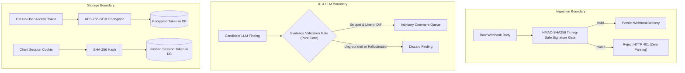

# ReviewLens — Security Model & Threat Mitigation

ReviewLens is designed with a defense-in-depth security model to protect GitHub repositories, user access tokens, and cloud infrastructure.

---

## 1. Core Threat Mitigations

---

## 2. Ingestion Security & Signature Verification

- **Timing-Safe HMAC-SHA256:** Webhook payloads are verified against `x-hub-signature-256` before JSON parsing. Unauthenticated requests are rejected immediately with HTTP 401.
- **Idempotent Delivery:** Deliveries are deduplicated on `delivery_id` in PostgreSQL to prevent replay attacks and duplicate job scheduling.
- **Payload Sanitization:** Diff retrieval limits PR size to `MAX_DIFF_BYTES` (500 KB) and truncates individual diff files to prevent denial-of-service memory exhaustion.

---

## 3. The Evidence Validation Gate (Hallucination Defense)

Large Language Models frequently hallucinate line numbers, file paths, and syntax errors. ReviewLens solves this by piping all candidate model findings through an independent, deterministic **Evidence Validation Gate** (`packages/core/src/review/evidence-validator.ts`):

1. **Path Verification:** The file path must exist in the PR's changed files list.
2. **Line Range Verification:** The specified line number must exist within a valid `+` addition hunk of the diff.
3. **Snippet Matching:** The code snippet reported by the model must match the exact trimmed content of the unified diff line.
4. **Advisory Posting:** Only candidate findings that pass all three checks are published as advisory review comments.

---

## 4. Authentication, Session & Token Security

- **PKCE S256:** GitHub OAuth implements Proof Key for Code Exchange (RFC 7636) using SHA-256 code challenges and single-use state transactions stored in PostgreSQL.
- **AES-256-GCM Encryption at Rest:** User access tokens are encrypted using AES-256-GCM with unique 96-bit initialization vectors and 128-bit authentication tags.
- **Hashed Session Tokens:** The raw session token is sent only to the browser as an `HttpOnly`, `Secure`, `SameSite=Lax` cookie. Only the SHA-256 hash is persisted in the database.
- **CSRF Double-Submit Protection:** State-changing API routes require verified CSRF tokens via `x-csrf-token` matching the client cookie.

---

## 5. Host & Container Security

- **Unprivileged Runtime:** Application processes run as non-root user `node` (UID 1000).
- **Network Isolation:** PostgreSQL is not published to host ports and is accessible only on the internal Docker network `reviewlens_internal`.
- **Restricted CI/CD Deployment:** The `deploy-reviewlens` account has no login shell or password; its sudo permissions are strictly constrained to `/opt/reviewlens/bin/deploy.sh` and `/opt/reviewlens/bin/ops-check.sh`.
